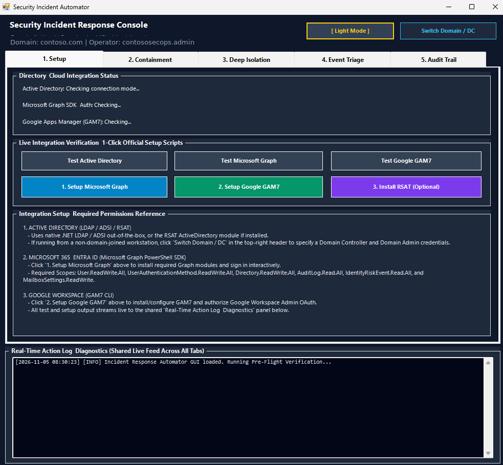
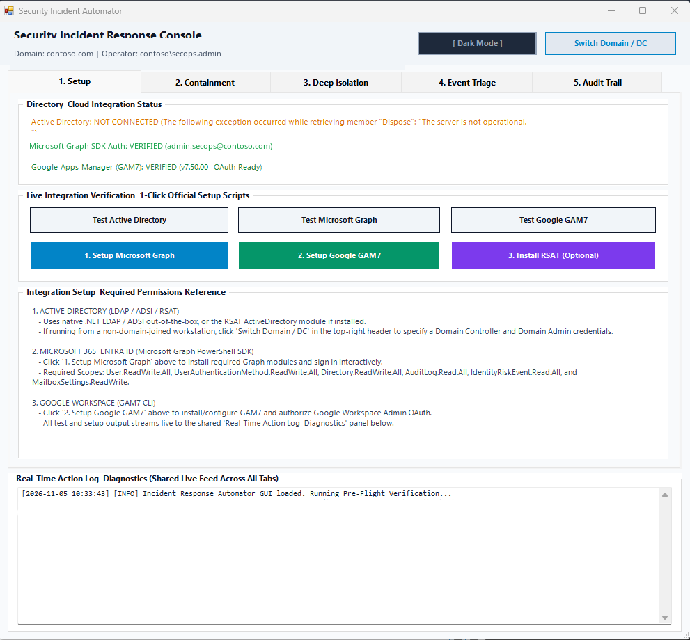
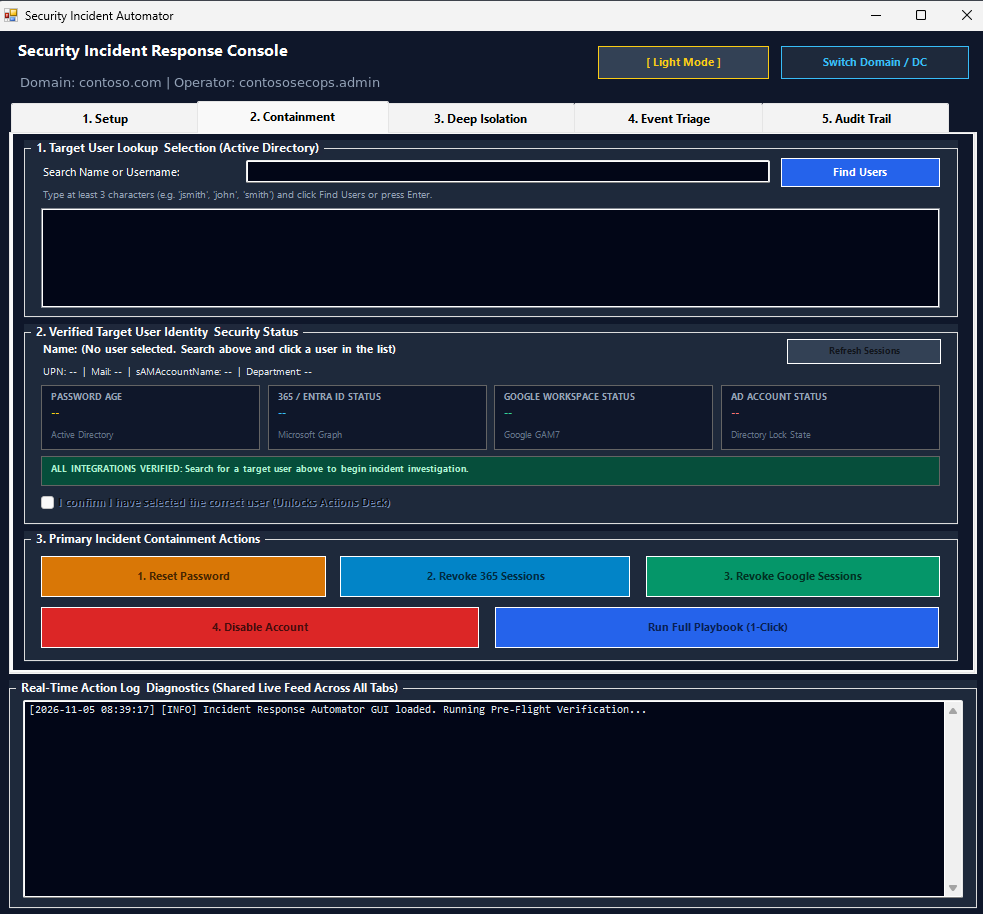
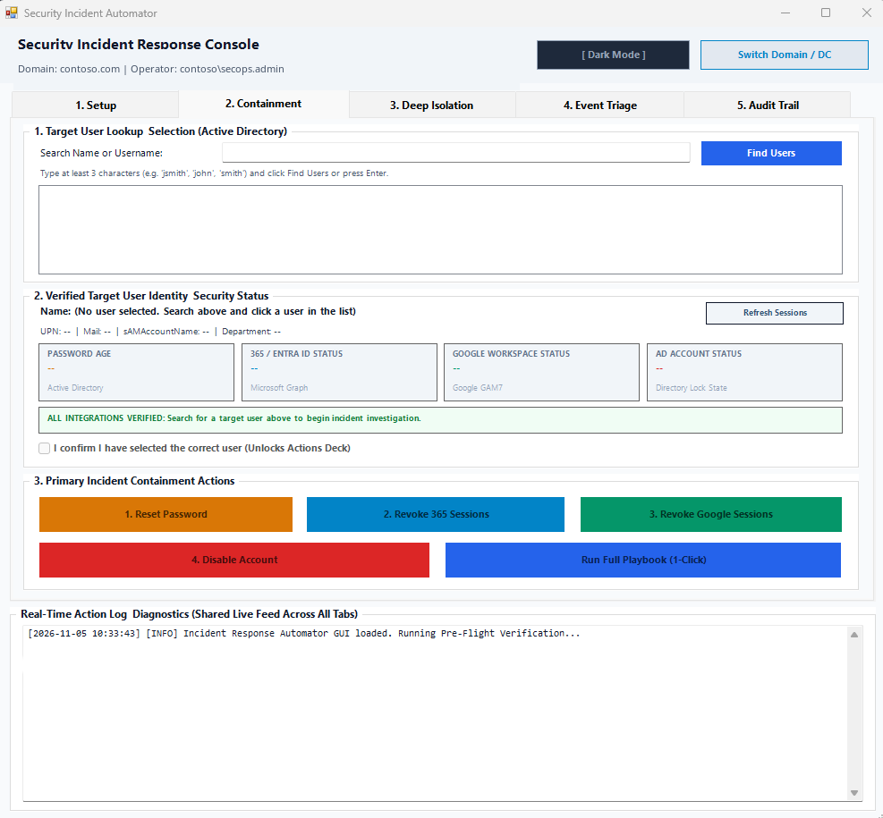
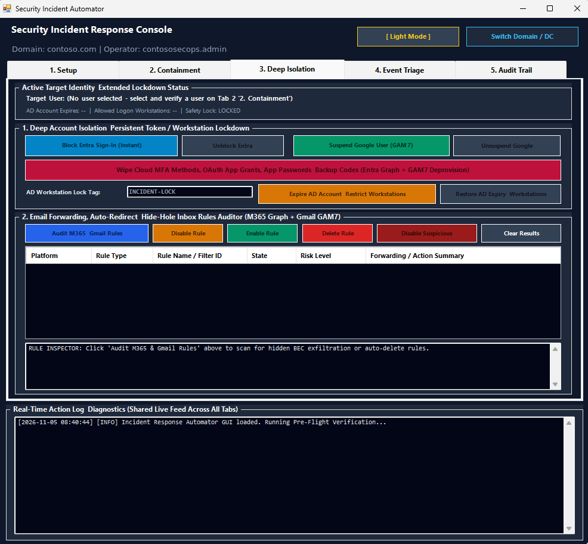
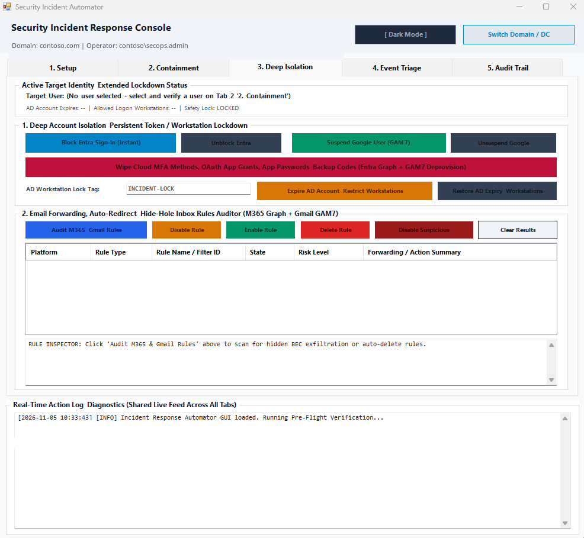
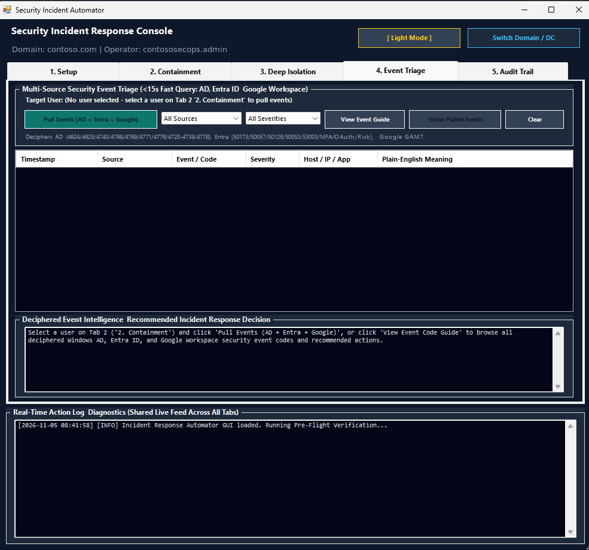
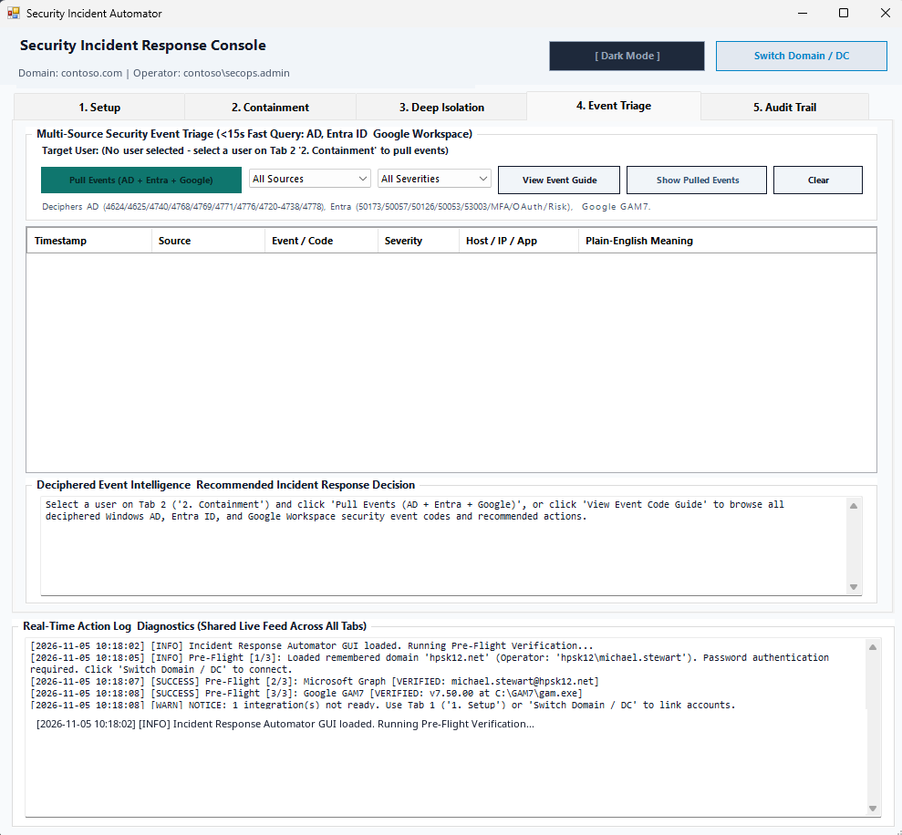
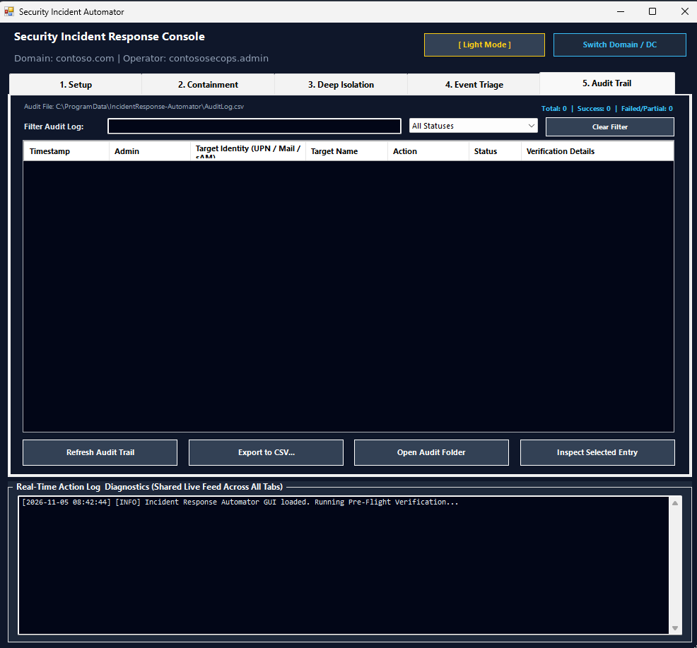
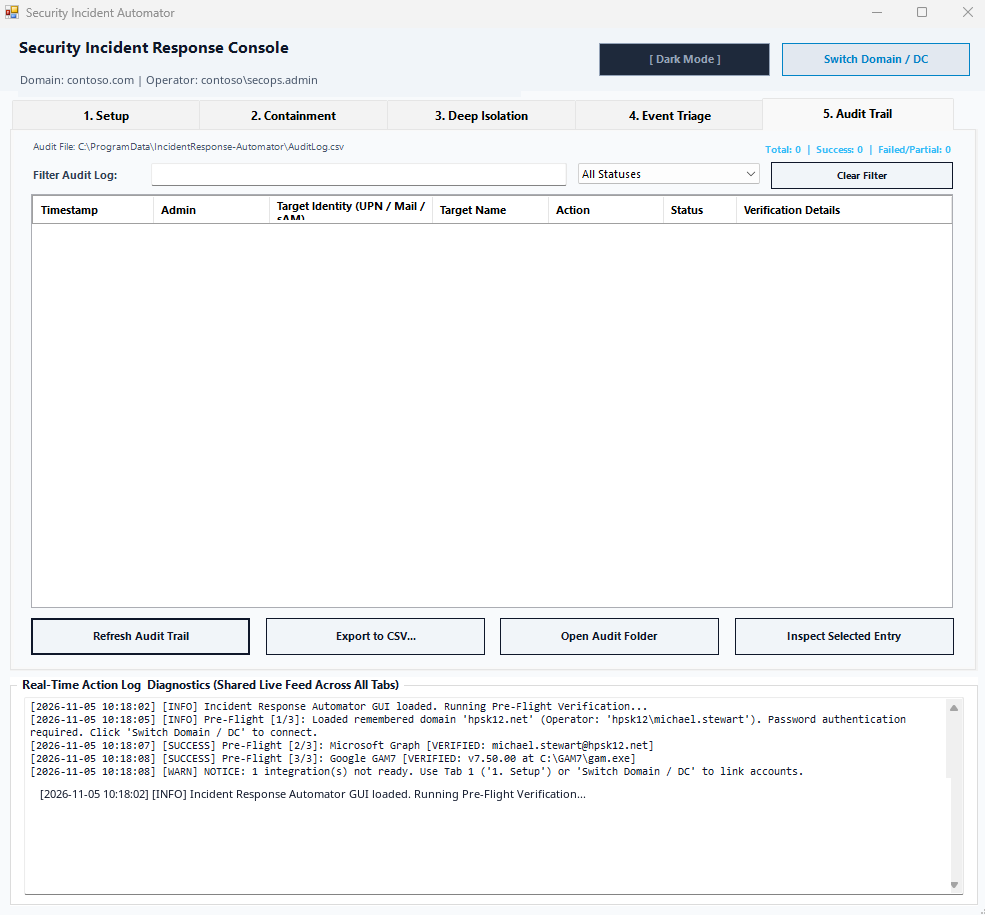

# Security Incident Response Automator

[](https://microsoft.com)
[](https://learn.microsoft.com/powershell/)
[](https://dotnet.microsoft.com)
[](LICENSE)
[](CHANGELOG.md)

A domain-agnostic incident containment console and forensic security triage utility for hybrid enterprise environments spanning **Active Directory Domain Services (AD DS)**, **Microsoft Entra ID (Microsoft 365)**, and **Google Workspace**.

Engineered for Cybersecurity Analysts, System Administrators, and Incident Responders to isolate compromised accounts, revoke active authentication sessions, neutralize malicious mailbox forwarding rules, and triage multi-source security events from a unified native Windows interface.

---

## Visual Tour & Interface Overview

The console is organized into five structured tabs corresponding to standard incident response containment stages:

### Tab 1: Integrations & Pre-Flight Setup
Live connection diagnostics, multi-domain profile switching, credential health checks, and one-click integration setup for Active Directory, Microsoft Graph, and Google Workspace.

<table>
  <tr>
    <td align="center"><b>Dark Mode</b></td>
    <td align="center"><b>Light Mode</b></td>
  </tr>
  <tr>
    <td></td>
    <td></td>
  </tr>
</table>

### Tab 2: Incident Containment Deck
Multi-attribute Active Directory user lookup, live multi-provider session telemetry, safety lock verification gate, and primary containment actions.

<table>
  <tr>
    <td align="center"><b>Dark Mode</b></td>
    <td align="center"><b>Light Mode</b></td>
  </tr>
  <tr>
    <td></td>
    <td></td>
  </tr>
</table>

### Tab 3: Deep Isolation & Mailbox Forwarding Rules Auditor
Instant cloud sign-in blocking, Google Workspace suspension, rogue MFA/OAuth grant eviction, Kerberos KDC hard-locking, and mailbox rule exfiltration scanner.

<table>
  <tr>
    <td align="center"><b>Dark Mode</b></td>
    <td align="center"><b>Light Mode</b></td>
  </tr>
  <tr>
    <td></td>
    <td></td>
  </tr>
</table>

### Tab 4: Multi-Source Security Event Triage
Live telemetry ingestion across Domain Controllers, Entra ID sign-in logs, and Google login reports with plain-English event translation, live keyword highlighting, and response recommendations.

<table>
  <tr>
    <td align="center"><b>Dark Mode</b></td>
    <td align="center"><b>Light Mode</b></td>
  </tr>
  <tr>
    <td></td>
    <td></td>
  </tr>
</table>

### Tab 5: Forensic Compliance Audit Trail
Filterable, searchable audit logging with CSV export sanitization, recording every administrative operation locally for compliance, forensic verification, and incident reporting.

<table>
  <tr>
    <td align="center"><b>Dark Mode</b></td>
    <td align="center"><b>Light Mode</b></td>
  </tr>
  <tr>
    <td></td>
    <td></td>
  </tr>
</table>

---

## Core Capabilities at a Glance

* **Single-Click Universal Containment:** Reset Active Directory passwords (with optional forced change at next logon), invalidate Microsoft 365 OAuth refresh tokens, terminate Google Workspace web and mobile sessions, and disable directory accounts in under 10 seconds.
* **Dual Active Directory Engine:** Operates via native .NET `System.DirectoryServices` (LDAP/ADSI over TCP/389 or LDAPS over TCP/636) without requiring Remote Server Administration Tools (RSAT), while automatically leveraging the RSAT `ActiveDirectory` module when available.
* **Multi-Domain Profiles & Encrypted Credential Vault:** Isolate Active Directory, Microsoft Graph, and Google Workspace configurations per customer or domain profile. Saved AD credentials are encrypted to the current workstation and Windows user via **Windows DPAPI (`CurrentUser`)**, safeguarded by anti-lockout pre-bind health checks and an optional application-wide **`Master Passphrase`**.
* **Deep Account Isolation:**
  * Disables Entra ID sign-in immediately via Microsoft Graph, closing the directory synchronization delay.
  * Suspends Google Workspace accounts via GAM7 with verified state convergence.
  * Evicts persistent access mechanisms across Entra ID and Google Workspace: third-party OAuth permission grants, MFA registrations, application-specific passwords, and 2-step verification backup codes.
  * Forces immediate Kerberos KDC ticket invalidation by expiring the AD account timestamp (`0x12: KDC_ERR_CLIENT_REVOKED`) and restricting allowed workstations.
* **Business Email Compromise (BEC) Remediation:** Audits Microsoft 365 inbox rules and Gmail forwarding filters, flagging external forwarding, stealth deletion, and hidden folder routing with single-rule or bulk remediation.
* **Plain-English Event Decoder:** Pulls security events across Windows Domain Controllers, Entra ID, and Google Workspace, translating numeric codes into plain-English analysis with live search highlighting and recommended actions.
* **Built-In Update Notifier & Theme Switcher:** Automatically checks for newer releases on launch (`v<version>` or `Update Available` in the header) and toggles smoothly between Dark Mode and Light Mode.

---

## Operating System & Prerequisite Requirements

| Component | Minimum Requirement | Recommended |
| :--- | :--- | :--- |
| **Operating System** | Windows 10 (1809+), Windows 11, Windows Server 2016+ | Windows 11 Enterprise / Windows Server 2022 |
| **PowerShell Runtime** | Windows PowerShell 5.1 (Built into Windows) | Windows PowerShell 5.1 (`-STA`) |
| **.NET Framework** | .NET Framework 4.8 | .NET Framework 4.8.1 |
| **Active Directory** | LDAP network access to Domain Controller (TCP 389/636) | Domain-joined workstation or Domain Admin credentials |
| **Microsoft 365** | Microsoft Graph PowerShell SDK (`Authentication`, `Users`) | Installed via setup launcher on Tab 1 |
| **Google Workspace** | Google Apps Manager 7 (GAM7 CLI v7.50+) | Installed via setup launcher on Tab 1 |

---

## Deployment & Execution Options

### Option 1: Batch Launcher (Recommended)
Double-click `Launch-IncidentAutomator.bat` in Windows Explorer or run from an elevated command prompt:
```cmd
Launch-IncidentAutomator.bat
```
*Unblocks downloaded files, enforces Single-Threaded Apartment (`-STA`) mode, and launches the desktop interface.*

### Option 2: Direct Execution via PowerShell
```powershell
powershell.exe -NoProfile -ExecutionPolicy Bypass -STA -File .\IncidentResponse-Automator.ps1
```

### Option 3: Compile to Standalone Binary (`IncidentResponse.exe`)
1. Double-click `Compile-To-EXE.cmd`.
2. The compiler validates script syntax, acquires `PS2EXE` if needed, and outputs a standalone portable `IncidentResponse.exe`.

---

## Operator User Guide

### 1. Pre-Flight Verification & Integration Setup (Tab 1)
On first launch, if no **Primary Domain Profile** exists yet, a startup prompt lets you designate this environment as your **Primary (Home) Domain Profile** or configure a temporary assisting profile while keeping your Primary slot clean.

1. Open **Tab 1 (`1. Setup`)**.
2. Use the top **Profile** bar (**`Switch Profile`**, **`+ New Profile`**, **`Manage / AD...`**) to switch between or create isolated Domain Profiles.
3. Review the connection status badges for **Active Directory**, **Microsoft Graph**, and **Google Workspace (GAM7)**.
4. Use the three service columns to test, set up, or switch accounts for each provider:
   * **Active Directory:** **`Test Active Directory`** | **`Install RSAT (Optional)`** | **`Switch AD Account / Domain`**
   * **Microsoft Graph:** **`Test Microsoft Graph`** | **`1. Setup Microsoft Graph`** | **`Switch Graph Account`**
   * **Google GAM7:** **`Test Google GAM7`** | **`2. Setup Google GAM7`** | **`Switch GAM Account`**

### 2. Multi-Domain Profiles, Saved Credentials & Master Passphrase
1. Click **`Manage / AD...`** (or **`Switch AD Account / Domain`**) to open the profile and AD switcher.
2. Select an existing profile or use **`+ New`**, **`Set Primary`**, **`Rename`**, or **`Delete`** to manage isolated environments.
3. Click **`Auto-Detect Domain`** to discover the workstation domain or active network DNS suffix, or enter a target domain FQDN or Domain Controller hostname/IP.
4. Check **`Use alternate Domain Admin credentials`** when authenticating from a non-domain workstation or elevated admin account. Optionally save credentials to the workstation's encrypted DPAPI vault for automatic startup connection.
5. Click **`Connect & Switch Profile`** to verify Active Directory connectivity and activate the profile, or **`Switch Cloud Only (Skip AD)`** when triaging off-VPN without Domain Controller access.
6. Use Tab 1's **Credential Health & Encrypted AD Vault** panel to run **`Validate Credential Health`**, **`Detect Network & Auto-Connect`**, **`Configure Saved AD Creds...`**, or **`Purge Saved Creds`**.
7. **Optional Master Passphrase:** Click **`Master Passphrase`** in the top-right header to set an application-wide passphrase protecting all saved Domain Profiles. When enabled, the console prompts for the passphrase on startup before connecting. From the **`Master Passphrase`** menu you can:
   * **Change Passphrase:** Update the active passphrase after confirming the current one.
   * **Remove Passphrase:** Disable the startup lock after confirming your current passphrase while keeping your saved DPAPI domain credentials intact.
   * **Remove Passphrase & All Creds:** Emergency break-glass reset (requires no passphrase if forgotten). Displays a red warning listing everything that will be wiped (Master Passphrase, Domain Profiles, Active Directory credentials, Microsoft Graph sessions, and Google GAM7 profiles) followed by a final **`Are you sure?`** confirmation before clearing stored credentials from the computer.
8. **Updates & Changelog:** The top-right header badge checks GitHub automatically on startup, displaying **`v<version>`** when current or **`Update Available`** when a newer version is published. Click it anytime to view the changelog, re-check for updates, or apply an update and restart.

### 3. Locating & Verifying a Compromised Account (Tab 2)
1. Open **Tab 2 (`2. Containment`)**.
2. Enter a name, username, or email address (minimum 3 characters) and press **Enter** or click **`Find Users`**.
3. Select the target account from the results list to populate the four live status cards (**Password Age**, **365 / Entra ID Status**, **Google Workspace Status**, and **AD Account Status**).
4. Verify the account details and check **`I confirm I have selected the correct user`** to unlock the containment action buttons.

### 4. Executing Primary Containment Actions (Tab 2)
* **`1. Reset Password`:** Opens the password reset dialog with custom entry or random 16-character generation and an optional toggle to require password change at next logon.
* **`2. Revoke 365 Sessions`:** Invalidates active Microsoft 365 / Entra ID refresh tokens across Outlook, Teams, OneDrive, and mobile clients.
* **`3. Revoke Google Sessions`:** Terminates active Google Workspace browser cookies and mobile app sessions.
* **`4. Disable Account`:** Disables the Active Directory account and confirms the updated state immediately.
* **`Run Full Playbook (1-Click)`:** Executes all four containment steps sequentially with status verification between each stage.

### 5. Deep Account Isolation & Mailbox Rule Auditing (Tab 3)
1. Open **Tab 3 (`3. Deep Isolation`)**.
2. **`Block Entra Sign-In (Instant)`** blocks cloud sign-in directly in Entra ID without waiting for directory synchronization.
3. **`Suspend Google User (GAM7)`** suspends the user account in Google Workspace.
4. **Cloud Persistence Eradication:** Run targeted wipes individually or all together:
   * **`Wipe Entra 2FA Methods`** — Deletes non-password Entra MFA registrations (Authenticator, SMS/phone, FIDO2 keys, Software OATH, Temporary Access Passes, and Email).
   * **`Wipe Entra OAuth Grants`** — Revokes Entra refresh tokens and removes third-party OAuth consent grants.
   * **`Wipe Google 2FA Methods`** — Turns off Google 2-Step Verification (2FA) enrollments, security keys, and backup codes.
   * **`Wipe Google OAuth Grants`** — Revokes Google OAuth app grants, Application-Specific Passwords, and backup codes.
   * **`Wipe All (Entra + GAM7)`** — Runs all four cloud wipe operations in sequence.
5. **`Expire AD Account & Restrict Workstations`** expires the AD account timestamp to invalidate active Kerberos TGTs (`0x12`) and locks `userWorkstations` to `INCIDENT-LOCK`.
6. **Mailbox Rules Auditor:** Click **`Audit M365 & Gmail Rules`** to scan Microsoft 365 inbox rules and Gmail filters/forwarding settings. Suspicious external forwards and stealth-delete rules are flagged for single-rule (**`Disable Rule`**, **`Delete Rule`**) or bulk (**`Disable Suspicious`**) remediation.

### 6. Triaging Security Events (Tab 4)
1. Open **Tab 4 (`4. Event Triage`)**.
2. Click **`Pull Events (AD + Entra + Google)`** to retrieve Domain Controller security logs, Entra ID sign-in events, and Google login activity.
3. Filter by source or severity dropdowns, or type in the **`Filter:`** box to search across both the results table and the selected event details with live match highlighting.
4. Select any event to read its plain-English explanation, recommended response decision, and raw telemetry.
5. Click **`View Event Guide`** to search and browse the built-in Windows, Entra, and Google security code dictionary offline, then **`Show Pulled Events`** to return to your pulled results.

### 7. Forensic Compliance Audit Trail (Tab 5)
1. Open **Tab 5 (`5. Audit Trail`)**.
2. Every containment operation is recorded locally to `C:\ProgramData\IncidentResponse-Automator\AuditLog.csv`.
3. Search or filter entries by status (`SUCCESS`, `PARTIAL`, `FAILED`), double-click or click **`Inspect Selected Entry`** to view full details, or click **`Export to CSV...`** to generate a sanitized compliance report.

---

## Companion Documentation

| Document | Purpose |
| :--- | :--- |
| [**`QUICK_START.md`**](QUICK_START.md) / [`QUICK_START.txt`](QUICK_START.txt) | Fast-start launch, first-time setup, and initial containment checklist |
| [**`README-extended.md`**](README-extended.md) / [`README-extended.txt`](README-extended.txt) | Engineering architecture, wire protocols, LDAP/Graph/GAM specs, and UI control internals |
| [**`CHANGELOG.md`**](CHANGELOG.md) | Chronological release history and version changes |
| [**`SECURITY.md`**](SECURITY.md) | Network communication model, credential storage, safeguards, and as-is policy |
| [**`DISCLAIMER.md`**](DISCLAIMER.md) | Full legal disclaimer and liability waiver |
| [**`LICENSE`**](LICENSE) / [**`NOTICE`**](NOTICE) | Apache License 2.0 and commercial attribution terms |

---

## Permissive Commercial Use, Forking & Shout-Out Policy

* **Open Use & Forking:** Anyone is free to use, copy, modify, merge, publish, distribute, sublicense, and/or fork this application and its source code under the terms of the [Apache License, Version 2.0](LICENSE).
* **Commercial & For-Profit Use:** Anyone is permitted to sell, commercialize, or incorporate any part of this software into a paid or commercial product or service, subject only to leaving a quick public shout-out or repository attribution on this project's official GitHub repository (e.g., via GitHub Issues or Discussions). **You do NOT need to wait for approval or a response before proceeding.**

---

## Legal Disclaimer & No Maintenance Obligation

* **Use Entirely at Your Own Risk:** This software is provided strictly on an **"AS IS"** and **"AS AVAILABLE"** basis without warranties or conditions of any kind.
* **Mandatory User Code Review:** Administrative and incident containment tools operate with high privileges across enterprise identity providers. **It is 100% the user's sole responsibility to read, inspect, audit, and understand the source code before executing it.**
* **Zero Liability:** The author(s), contributor(s), and maintainer(s) shall have **absolutely zero responsibility or liability** for any damages, losses, system downtime, directory corruption, or data loss whatsoever resulting from or relating to the execution, use, or modification of this software.
* **No Maintenance Obligation:** The author is under **zero obligation** to update, patch, maintain, or support this application.

For complete legal terms and disclaimers, please read [DISCLAIMER.md](DISCLAIMER.md), [NOTICE](NOTICE), and [LICENSE](LICENSE).
