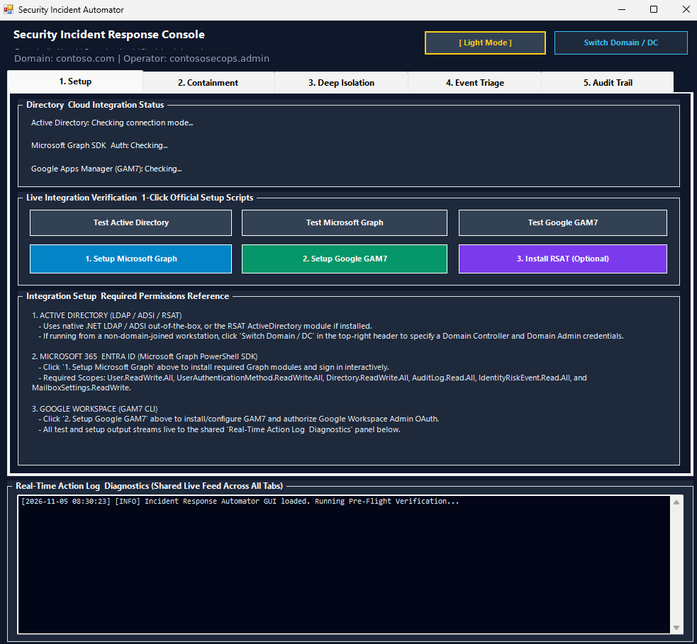
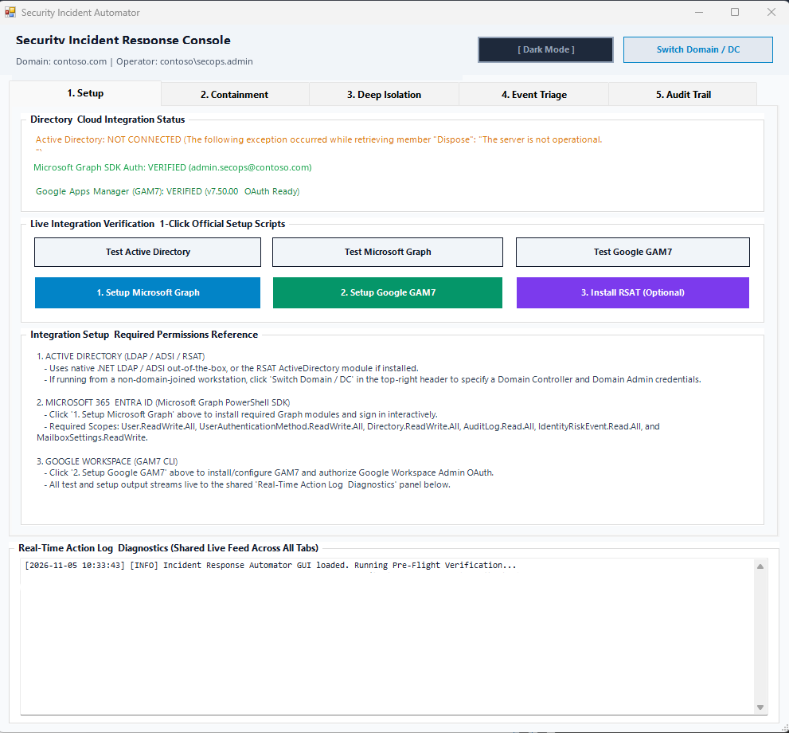
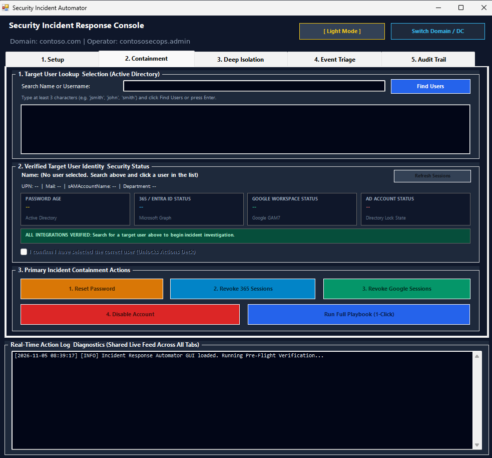
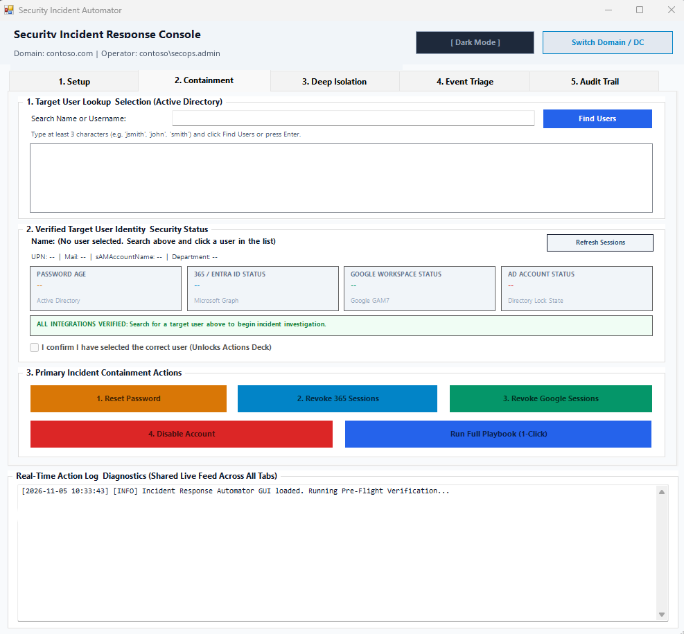
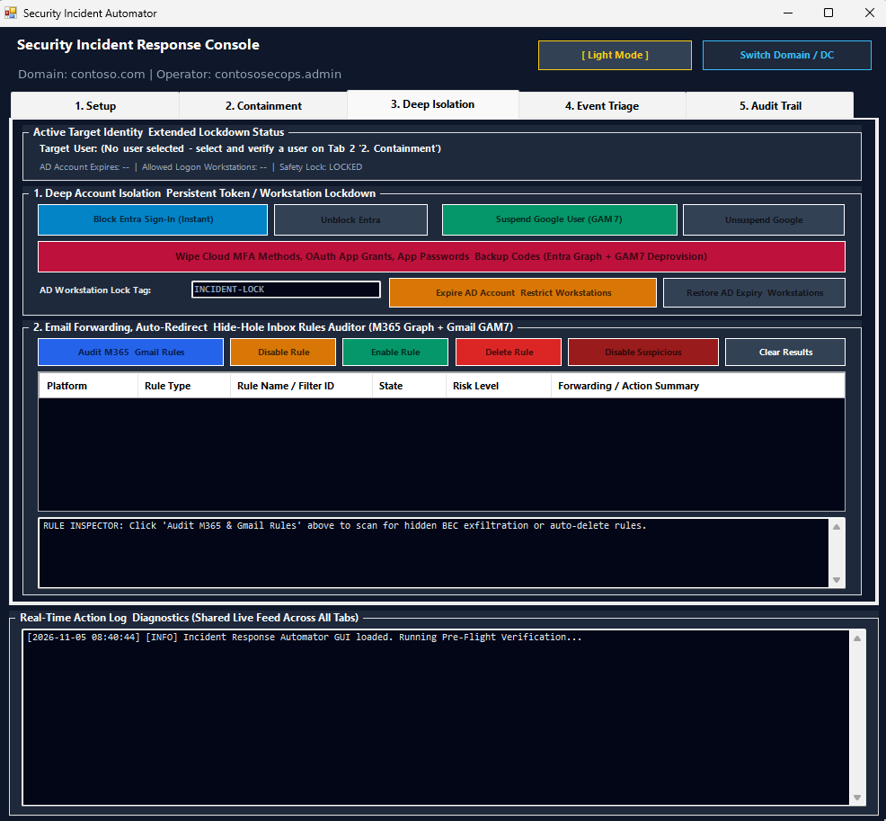
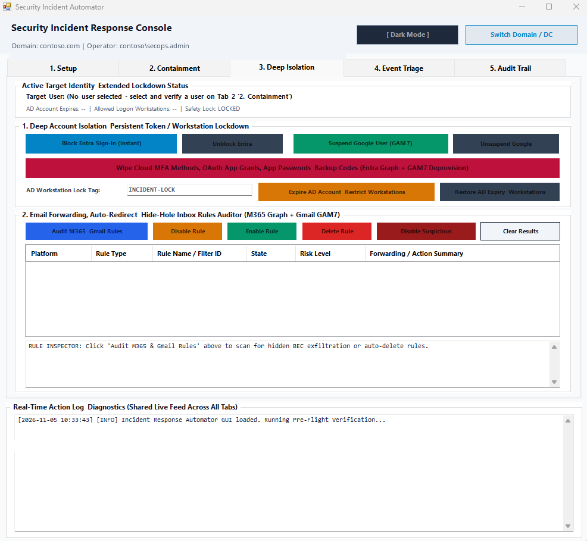
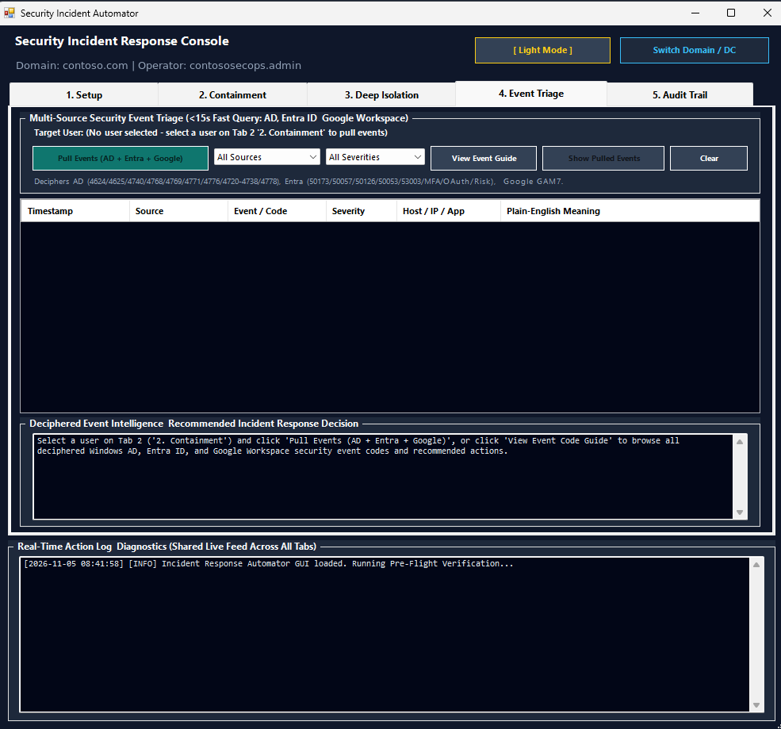
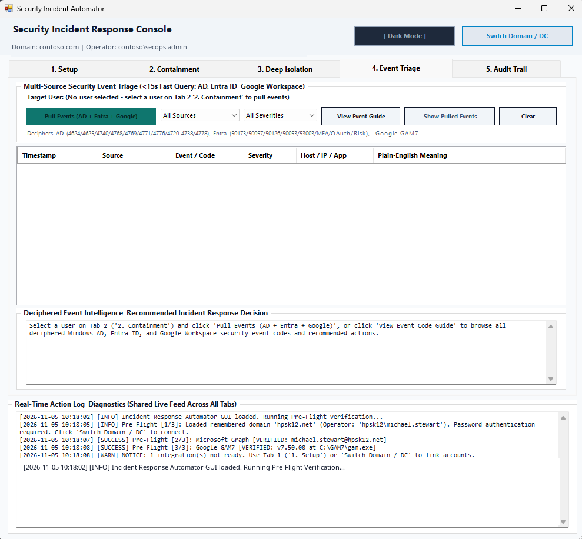
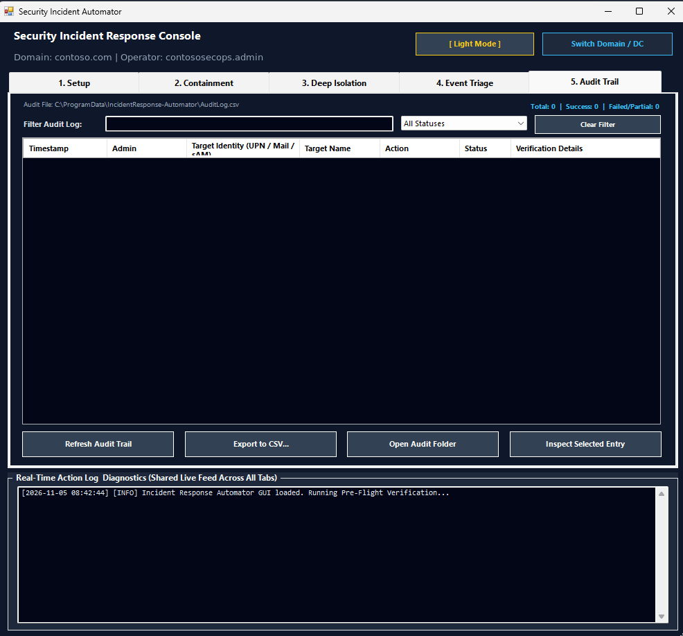
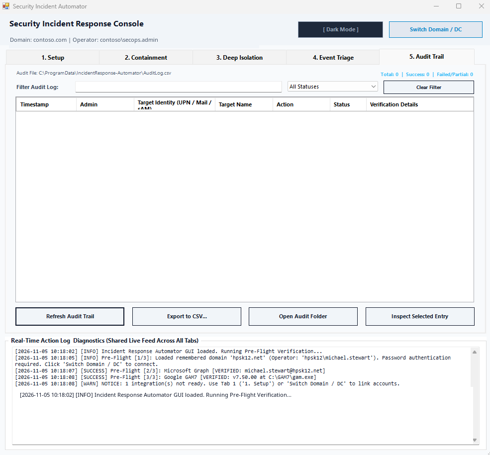

# Security Incident Response Automator

[](https://microsoft.com)
[](https://learn.microsoft.com/powershell/)
[](https://dotnet.microsoft.com)
[](LICENSE)
[](CHANGELOG.md)

A high-performance, domain-agnostic administrative incident containment console and security forensics triage utility for hybrid enterprise environments spanning **Active Directory Domain Services (AD DS)**, **Microsoft Entra ID (Microsoft 365)**, and **Google Workspace**.

Engineered for Cybersecurity Analysts, System Administrators, and Incident Responders to rapidly isolate compromised user accounts, revoke active authentication sessions, neutralize malicious mailbox forwarding rules, and triage multi-source security events from a unified, native Windows interface.

---

## Visual Tour & Interface Overview

The console is organized into five structured tabs corresponding to standard incident response containment stages:

### Tab 1: Integrations & Pre-Flight Setup
Live diagnostic status of all directory and cloud services, with automated one-click installation and verification scripts.

<table>
  <tr>
    <td align="center"><b>Dark Mode</b></td>
    <td align="center"><b>Light Mode</b></td>
  </tr>
  <tr>
    <td></td>
    <td></td>
  </tr>
</table>

### Tab 2: Incident Containment Deck
Multi-attribute Active Directory user search, live multi-provider session telemetry, safety lock verification gate, and primary containment actions.

<table>
  <tr>
    <td align="center"><b>Dark Mode</b></td>
    <td align="center"><b>Light Mode</b></td>
  </tr>
  <tr>
    <td></td>
    <td></td>
  </tr>
</table>

### Tab 3: Deep Isolation & Mailbox Forwarding Rules Auditor
Instant cloud sign-in blocking, Google Workspace account suspension, rogue MFA/OAuth grant eviction, Kerberos KDC hard-locking, and mailbox rule exfiltration scanner.

<table>
  <tr>
    <td align="center"><b>Dark Mode</b></td>
    <td align="center"><b>Light Mode</b></td>
  </tr>
  <tr>
    <td></td>
    <td></td>
  </tr>
</table>

### Tab 4: Multi-Source Security Event Triage
Live telemetry ingestion across Domain Controllers, Entra ID sign-in logs, and Google audit records with automated plain-English translation and response recommendations.

<table>
  <tr>
    <td align="center"><b>Dark Mode</b></td>
    <td align="center"><b>Light Mode</b></td>
  </tr>
  <tr>
    <td></td>
    <td></td>
  </tr>
</table>

### Tab 5: Forensic Compliance Audit Trail
Filterable, searchable audit logging with CSV field sanitization, recording every administrative operation locally for compliance, forensic verification, and insurance reporting.

<table>
  <tr>
    <td align="center"><b>Dark Mode</b></td>
    <td align="center"><b>Light Mode</b></td>
  </tr>
  <tr>
    <td></td>
    <td></td>
  </tr>
</table>

---

## Core Capabilities at a Glance

* **Single-Click Universal Containment:** Reset Active Directory password (with forced change at next logon), invalidate Microsoft 365 OAuth refresh tokens, terminate Google Workspace web/mobile sessions, and disable directory accounts in under 10 seconds.
* **Dual Active Directory Engine:** Operates seamlessly via native .NET `System.DirectoryServices` (LDAP/ADSI over TCP/389 or LDAPS over TCP/636) without requiring Remote Server Administration Tools (RSAT), while automatically leveraging the RSAT `ActiveDirectory` module if present.
* **Multi-Domain Profiles & Auto-Detection:** Automatically discovers local domain membership, forest roots, and DNS suffix lists, with isolated **Domain Profiles** (`Profiles\<id>`) for AD, Microsoft Graph, and GAM7—making single-domain use zero-step while letting multi-tenant technicians switch environments in one click.
* **Deep Account Isolation:**
  * Immediately disables Entra ID sign-in via Microsoft Graph REST API, closing the 30-minute Entra Connect synchronization gap.
  * Suspends Google Workspace accounts via GAM7 CLI with multi-pass convergence verification.
  * Evicts persistent cloud persistence mechanisms: deletes third-party OAuth app grants, wipes SMS/TOTP/FIDO authentication methods, and clears Google app passwords and 2-step verification backup codes.
  * Forces immediate Kerberos KDC ticket invalidation by expiring the AD account timestamp (`0x12: KDC_ERR_CLIENT_REVOKED`) and restricts allowed workstations to sentinel values.
* **Business Email Compromise (BEC) Remediation:** Audits Microsoft 365 inbox message rules and Gmail routing filters, flagging external forwarding targets, stealth deletion, and hide-hole routing with one-click single or bulk remediation.
* **Plain-English Event Decoder:** Pulls real-time security events across Windows Domain Controllers, Entra ID, and Google Workspace, translating obscure error codes into human-readable triage intelligence with recommended incident response steps.
* **Theme Customization:** Instant one-click toggle between High-Contrast Dark Mode and Professional Light Mode across all windows, headers, text controls, and data grids.

---

## Operating System & Prerequisite Requirements

| Component | Minimum Requirement | Recommended |
| :--- | :--- | :--- |
| **Operating System** | Windows 10 (1809+), Windows 11, Windows Server 2016+ | Windows 11 Enterprise / Windows Server 2022 |
| **PowerShell Runtime** | Windows PowerShell 5.1 (Built into Windows) | Windows PowerShell 5.1 (Single-Threaded Apartment `-STA`) |
| **.NET Framework** | .NET Framework 4.8 | .NET Framework 4.8.1 |
| **Active Directory** | LDAP network access to Domain Controller (TCP 389/636) | Domain-joined workstation or Domain Admin credentials |
| **Microsoft 365** | Microsoft Graph PowerShell SDK (`Authentication`, `Users`) | Installed via 1-Click launcher on Tab 1 |
| **Google Workspace** | Google Apps Manager 7 (GAM7 CLI v7.50+) | Installed via 1-Click launcher on Tab 1 |

---

## Deployment & Execution Options

The project is distributed as self-contained source files that can be executed directly or compiled into a standalone Windows binary:

### Option 1: Fast Launch via Batch Wrapper (Recommended)
Double-click `Launch-IncidentAutomator.bat` in Windows Explorer or run from an elevated command prompt:
```cmd
Launch-IncidentAutomator.bat
```
*Automatically unblocks files, enforces Single-Threaded Apartment (`-STA`) execution, and launches the Windows Form interface.*

### Option 2: Direct Execution via PowerShell
Execute directly using Windows PowerShell 5.1:
```powershell
powershell.exe -NoProfile -ExecutionPolicy Bypass -STA -File .\IncidentResponse-Automator.ps1
```

### Option 3: Compile to Standalone Binary (`IncidentResponse.exe`)
To package the entire console and its embedded setup scripts into a single standalone portable executable:
1. Double-click `Compile-To-EXE.cmd`.
2. The script validates PowerShell AST syntax, checks or downloads the `PS2EXE` compilation tool, and generates an optimized `IncidentResponse.exe`.
3. The resulting binary runs natively on any Windows workstation without requiring PowerShell script files or console windows.

---

## Operator Step-by-Step User Guide

### 1. Pre-Flight Verification & Integration Setup (Tab 1)
Upon launch, if no **Primary Domain Profile** has been configured yet, a startup prompt asks whether this workstation/environment is your **Primary (Home) Domain Profile** or if you are temporarily assisting another domain—keeping your clean Primary slot reserved until you return to your home domain. You can also mark or change your Primary Profile at any time via **Manage / AD...** or **Switch AD Account / Domain** on Tab 1.

1. Navigate to **Tab 1 (`1. Setup`)**.
2. Use the top **Profile** bar (`Switch Profile`, `+ New Profile`, `Manage / AD...`) to select or create a Domain Profile if supporting multiple environments.
3. Review the connection indicators for **Active Directory**, **Microsoft Graph**, and **Google Workspace (GAM7)**.
4. Actions are grouped by **service column** so each provider's **Test** (Row 1), **Setup** (Row 2), and **Switch** (Row 3) controls line up vertically:
   * **Column 1 (Active Directory):** **Test Active Directory** | **Install RSAT (Optional)** | **Switch AD Account / Domain**
   * **Column 2 (Microsoft Graph):** **Test Microsoft Graph** | **1. Setup Microsoft Graph** *(device-code sign-in with `DisableLoginByWAM` enabled)* | **Switch Graph Account**
   * **Column 3 (Google GAM7):** **Test Google GAM7** | **2. Setup Google GAM7** | **Switch GAM Account**

### 2. Managing Domain Profiles & Switching Target Domains
If operating from a non-domain-joined laptop or managing multiple corporate/client domains and cloud tenants:
1. Open **Tab 1 (`1. Setup`)** and click **Manage / AD...** in the top Profile bar (or **Switch AD Account / Domain** in the Active Directory row).
2. Select an existing **Domain Profile** or click **+ New** to create an isolated profile (`%LOCALAPPDATA%\IncidentResponse-Automator\Profiles\<id>`), **Set Primary** to designate your home domain, **Rename**, or **Delete**.
3. Click **Auto-Detect Domain** to populate the local joined domain, or enter a target Domain FQDN or Domain Controller IP/hostname (e.g. `contoso.com`).
4. Check **Use alternate Domain Admin credentials (same domain or remote DC)** and enter administrative credentials (`DOMAIN\admin` and Password) if switching AD accounts or connecting from a workgroup PC (passwords stay in memory only).
5. Click **Connect & Switch Profile** to verify LDAP RootDSE connectivity and switch the active profile, or click **Switch Cloud Only (Skip AD)** for off-VPN cloud triage when an on-premises Domain Controller is unreachable.
6. Click **Check for Updates** in the upper header at any time to check GitHub releases, **View Changelog**, or run **Update & Restart** (which validates and auto-recompiles `IncidentResponse.exe` locally when running as an `.exe`).

### 3. Locating and Verifying a Compromised Identity (Tab 2)
1. Navigate to **Tab 2 (`2. Containment`)**.
2. Enter the user's name, username, or email into the search bar (minimum 3 characters, e.g. `alex.morgan@contoso.com` or `am8001`) and press **Enter** or click **Find Users**.
3. Select the correct user from the results list.
4. The console queries Active Directory, Entra ID, and Google Workspace, populating the 4 live security status cards:
   * **PASSWORD AGE:** Number of days since password last set.
   * **365 / ENTRA ID STATUS:** Live token validity state.
   * **GOOGLE WORKSPACE STATUS:** Live Google session state.
   * **AD ACCOUNT STATUS:** Active Directory directory lock and enabled status.
5. Review the user details and check the mandatory confirmation box:
   `[X] I confirm I have selected the correct user (Unlocks Actions Deck)`.

### 4. Executing Containment Actions (Tab 2)
* **1. Reset Password:** Opens an inline reset dialog. Enter a custom password or click **Generate** for a cryptographically random 16-character password. Automatically enforces `pwdLastSet = 0` so the user must select a private password at next logon.
* **2. Revoke 365 Sessions:** Calls Microsoft Graph `/v1.0/users/{id}/revokeSignInSessions`, invalidating all active refresh tokens across Outlook, Teams, OneDrive, and mobile apps.
* **3. Revoke Google Sessions:** Executes `gam user <id> signout`, terminating active web browser cookies and mobile app sessions.
* **4. Disable Account:** Sets the `userAccountControl` disabled flag in Active Directory with immediate LDAP read-back verification.
* **Run Full Playbook (1-Click):** Sequentially executes all four containment steps with full verification in under 10 seconds.

### 5. Applying Deep Account Isolation (Tab 3)
For high-severity or suspected Business Email Compromise (BEC) incidents:
1. Navigate to **Tab 3 (`3. Deep Isolation`)**.
2. **Block Entra Sign-In (Instant):** Directly writes `accountEnabled = false` to Microsoft Graph, blocking cloud access immediately without waiting for directory sync.
3. **Suspend Google User:** Freezes the user account in Google Admin SDK.
4. **Granular Cloud Persistence Wipe Actions (5 Symmetric Red Controls with Tooltips):** Run individually or all together:
   * **Wipe Entra 2FA Methods:** Purges non-password Entra MFA registrations (Microsoft Authenticator, Phone/SMS, FIDO2 security keys, Software OATH tokens, Temporary Access Passes, and Email methods).
   * **Wipe Entra OAuth Grants:** Revokes Entra refresh tokens and deletes third-party OAuth permission grants (`oauth2PermissionGrants`).
   * **Wipe Google 2FA Methods:** Runs `gam user <id> turnoff2sv` to turn off Google 2-Step Verification (2FA) enrollments, security keys, and backup verification codes.
   * **Wipe Google OAuth Grants:** Runs `gam user <id> deprovision` to revoke third-party Google OAuth app grants, Application-Specific Passwords (ASPs), and 2SV backup codes.
   * **Wipe All (Entra + GAM7):** Executes all four cloud persistence wipe steps sequentially in one click.
5. **Expire AD Account & Restrict Workstations:** Sets `accountExpires` to the past (forcing Kerberos KDC error `0x12`) and locks `userWorkstations` to `INCIDENT-LOCK`.

### 6. Auditing and Remediating Mailbox Rules (Tab 3)
1. On **Tab 3**, click **Audit M365 & Gmail Rules**.
2. The auditor inspects all inbox message rules and forwarding configurations.
3. Rules flagging external forwarding, auto-redirection, or stealth auto-deletion are highlighted as `HIGH RISK` or `SUSPICIOUS`.
4. Select a rule to inspect its conditions, then click **Disable Rule**, **Delete Rule**, or click **Disable Suspicious** to neutralize all rogue rules in one action.

### 7. Triaging Security Events (Tab 4)
1. Navigate to **Tab 4 (`4. Event Triage`)**.
2. Click **Pull Events (AD + Entra + Google)** to query Domain Controller security logs, Entra sign-in audit logs, and Google login reports.
3. Filter results by source or severity using the dropdown selectors.
4. Select any event to read its plain-English explanation and recommended incident response decision.
5. Click **View Event Code Guide** to browse the complete built-in dictionary of Windows, Entra, and Google security codes. Click **Show Pulled Events** to return to your query results without re-pulling.

### 8. Reviewing the Compliance Audit Trail (Tab 5)
1. Navigate to **Tab 5 (`5. Audit Trail`)**.
2. All administrative actions executed during the session are logged to `C:\ProgramData\IncidentResponse-Automator\AuditLog.csv`.
3. Filter logs by typing in the search box or selecting a status filter (`SUCCESS`, `PARTIAL`, `FAILED`).
4. Double-click or select an entry and click **Inspect Selected Entry** to view complete timestamp, operator, and API verification details.
5. Click **Export to CSV...** to generate an executive report for cybersecurity insurance or compliance documentation.

---

## Technical Documentation & Guides

For complete operator workflows, quick start instructions, and comprehensive technical architecture detailing internal LDAP queries, RFC 4511 protocol calls, Microsoft Graph REST endpoints, GAM7 commands, security event IDs, and DPI scaling engine internals:

* **Quick Start Guide:** [`QUICK_START.md`](QUICK_START.md) (Markdown) | [`QUICK_START.txt`](QUICK_START.txt) (Plain-Text)
* **Extended Technical Manual:** [`README-extended.md`](README-extended.md) (Markdown) | [`README-extended.txt`](README-extended.txt) (Plain-Text)
* **Offline Operator User Guide:** [`README.txt`](README.txt) (Plain-Text)

---

## Permissive Commercial Use, Forking & Shout-Out Policy

* **Open Use & Forking:** Anyone is free to use, copy, modify, merge, publish, distribute, sublicense, and/or fork this application and its source code under the terms of the [Apache License, Version 2.0](LICENSE).
* **Commercial & For-Profit Use:** Anyone is permitted to sell, commercialize, or incorporate any part of this software into a paid or commercial product or service, subject only to leaving a quick public shout-out or repository attribution on this project's official GitHub repository (e.g. via GitHub Issues or Discussions). **You do NOT need to wait for approval or a response before proceeding.**

---

## Legal Disclaimer & No Maintenance Obligation

* **Use Entirely at Your Own Risk:** This software is provided strictly on an **"AS IS"** and **"AS AVAILABLE"** basis without warranties or conditions of any kind.
* **Mandatory User Code Review:** Administrative and incident containment tools operate with high privileges across enterprise identity providers. **It is 100% the user's sole responsibility to read, inspect, audit, and understand the source code before executing it.**
* **Zero Liability:** The author(s), contributor(s), and maintainer(s) shall have **absolutely zero responsibility or liability** for any damages, losses, system downtime, directory corruption, data loss, or consequences whatsoever resulting from or relating to the execution, use, or modification of this software.
* **No Maintenance Obligation:** The author is under **zero obligation** to update, patch, maintain, or support this application. This software is released on an as-is basis with no SLA.

For complete legal terms and disclaimers, please read [DISCLAIMER.md](DISCLAIMER.md), [NOTICE](NOTICE), and [LICENSE](LICENSE).
